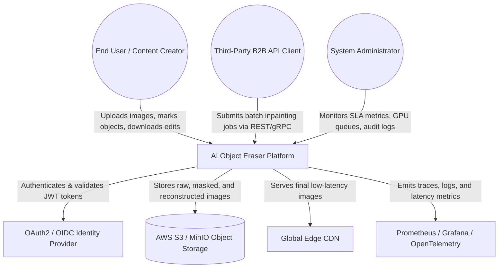
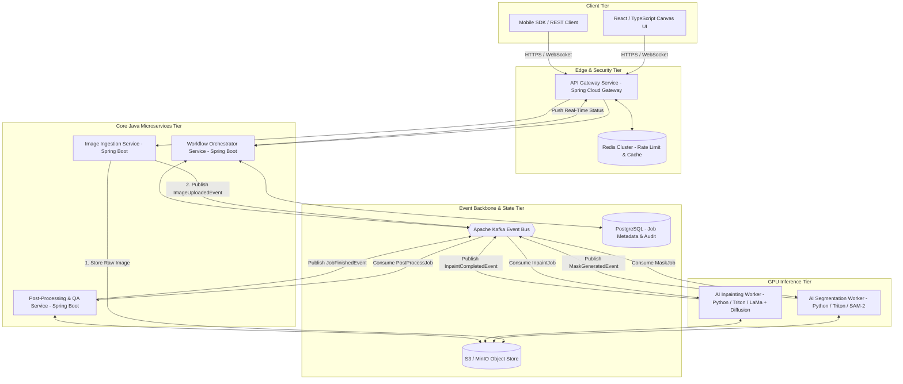
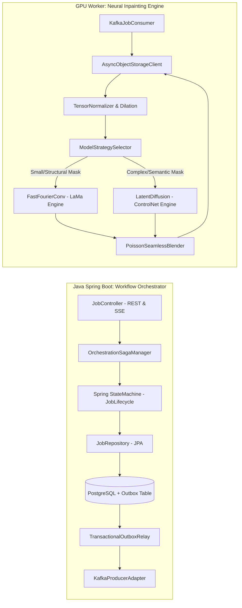
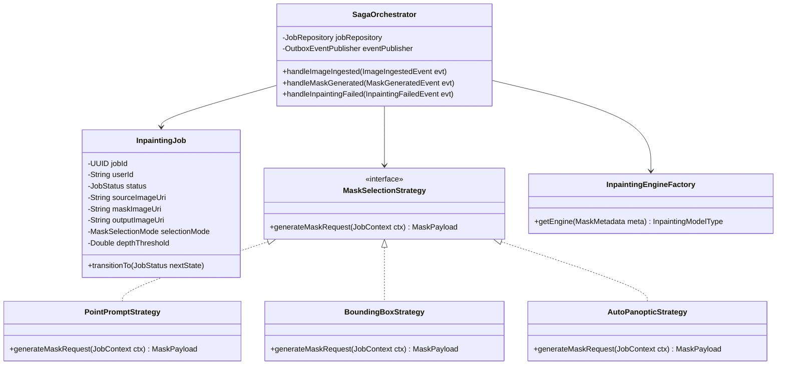
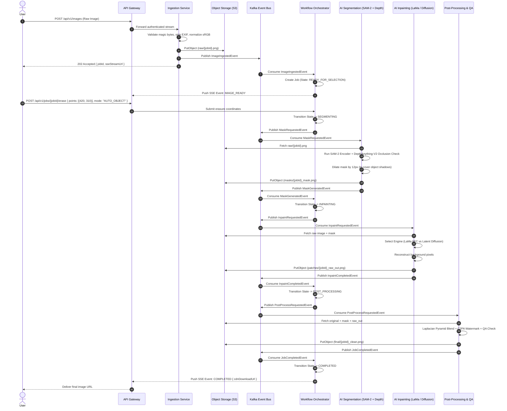

# 🎨 AI Object Eraser — Enterprise System Architecture & Technical Documentation

> **Repository:** [`coder-stat920715/ai-object-eraser`](https://github.com/coder-stat920715/ai-object-eraser)  
> **Architecture Style:** Event-Driven Microservices & Hybrid Inference Pipeline (Java / Spring Boot + Python / PyTorch / ONNX)  

---

## 📑 Table of Contents
1. [Executive Overview](#1-executive-overview)
2. [High-Level Design (HLD) & Low-Level Design (LLD) via The Four C's (C4 Model)](#2-high-level-design-hld--low-level-design-lld-via-the-four-cs-c4-model)
   - [Level 1: System Context (HLD)](#level-1-system-context-hld)
   - [Level 2: Container Architecture (HLD)](#level-2-container-architecture-hld)
   - [Level 3: Component Architecture (LLD)](#level-3-component-architecture-lld)
   - [Level 4: Code-Level Class & Sequence Architecture (LLD)](#level-4-code-level-class--sequence-architecture-lld)
3. [Deep-Dive Microservice Specifications (6-Parameter Matrix)](#3-deep-dive-microservice-specifications-6-parameter-matrix)
   - [3.1 API Gateway & Edge Router Service](#31-api-gateway--edge-router-service)
   - [3.2 Image Ingestion & Pre-Processing Service](#32-image-ingestion--pre-processing-service)
   - [3.3 Workflow Orchestration & Job State Service](#33-workflow-orchestration--job-state-service)
   - [3.4 AI Segmentation & Mask Generation Service](#34-ai-segmentation--mask-generation-service)
   - [3.5 AI Neural Inpainting & Reconstruction Service](#35-ai-neural-inpainting--reconstruction-service)
   - [3.6 Post-Processing, Quality Assurance & Delivery Service](#36-post-processing-quality-assurance--delivery-service)
4. [End-to-End Project Workflow](#4-end-to-end-project-workflow)
5. [Deep Dive: AI Algorithms & Mathematical Foundations](#5-deep-dive-ai-algorithms--mathematical-foundations)
   - [5.1 How Object Selection & Segmentation Works](#51-how-object-selection--segmentation-works)
   - [5.2 How Background Reconstruction (Inpainting) Works](#52-how-background-reconstruction-inpainting-works)
6. [Foreground vs. Background Disambiguation & Occlusion Prevention](#6-foreground-vs-background-disambiguation--occlusion-prevention)
7. [Risks of AI Object Erasers & Comprehensive Mitigation Strategies](#7-risks-of-ai-object-erasers--comprehensive-mitigation-strategies)
8. [Design Patterns Used (Java & Microservices)](#8-design-patterns-used-java--microservices)
   - [8.1 Java Enterprise & GoF Design Patterns](#81-java-enterprise--gof-design-patterns)
   - [8.2 Distributed Microservice Design Patterns](#82-distributed-microservice-design-patterns)

---

## 1. Executive Overview

**AI Object Eraser** is a distributed, fault-tolerant, cloud-native image editing platform that allows users to remove unwanted objects, photobombers, watermarks, or blemishes from high-resolution images while seamlessly reconstructing the occluded background. 

Unlike naive pixel-cloning tools, the system combines **Java Spring Boot** microservices (handling high-concurrency API orchestration, state management, security, and asynchronous event routing) with **GPU-accelerated AI Inference Workers** (running foundation segmentation models and Fourier/Diffusion-based neural inpainting networks).

---

## 2. High-Level Design (HLD) & Low-Level Design (LLD) via The Four C's (C4 Model)

To bridge executive architectural vision with concrete implementation details, the system architecture is structured using **Simon Brown’s C4 Model (Context, Containers, Components, Code)**.

### Level 1: System Context (HLD)
*Audience: Stakeholders, Product Managers, Enterprise Architects.*  
Illustrates how the AI Object Eraser interacts with external users and third-party ecosystems.

---

### Level 2: Container Architecture (HLD)
*Audience: Software Architects, DevOps, Platform Engineers.*  
Decomposes the platform into independently deployable microservices, message brokers, and data stores.

---

### Level 3: Component Architecture (LLD)
*Audience: Senior Developers, Tech Leads.*  
Zooms inside the **Workflow Orchestrator Service** and **AI Inference Pipeline** to expose internal modules, controllers, domain services, and adapters.

---

### Level 4: Code-Level Class & Sequence Architecture (LLD)
*Audience: Software Engineers implementing the codebase.*  
Illustrates the concrete Java class hierarchy using Strategy, Factory, State, and Builder patterns inside the Orchestration & Processing modules.

---

## 3. Deep-Dive Microservice Specifications (6-Parameter Matrix)

Below is the comprehensive architectural breakdown of every microservice across the **6 mandatory operational dimensions**.

---

### 3.1 API Gateway & Edge Router Service
*(Built with Java 21, Spring Cloud Gateway, Netty, Redis)*

1. **Primary Purpose & Key Responsibilities:**
   - Acts as the single unified ingress point for all external client traffic (Web UI, Mobile SDKs, B2B REST APIs).
   - Terminates TLS 1.3, validates OAuth2/OIDC JWT tokens, enforces per-tenant rate limiting, manages CORS policies, and routes synchronous REST calls and asynchronous Server-Sent Events (SSE) / WebSockets for real-time job progress updates.
2. **Measuring Success (KPIs):**
   - **Edge Routing Overhead:** $< 8\text{ ms}$ at $p_{99}$.
   - **Auth Validation Latency:** $< 3\text{ ms}$ via cached JWKS keys.
   - **Gateway Availability:** $\ge 99.99\%$ uptime.
   - **Rejected Malicious/Rate-Limited Traffic:** $100\%$ enforcement accuracy with zero false drops for paid tiers.
3. **Data Flow, Response Times & Failure Impact:**
   - **Data Flow:** Client $\rightarrow$ Load Balancer $\rightarrow$ API Gateway $\rightarrow$ Redis (Rate Limit Check) $\rightarrow$ Downstream Microservice.
   - **Response Times:** $p_{50} = 3\text{ ms}$, $p_{95} = 6\text{ ms}$, $p_{99} = 11\text{ ms}$.
   - **Failure Impact:** *Critical (Severity-1).* If completely down, external clients lose access to the platform. Mitigated via multi-AZ active-active deployment behind AWS ALB / NGINX Ingress.
4. **Technologies, Advantages & Limitations:**
   - **Technologies:** Spring Cloud Gateway (Project Reactor / Netty), Redis Lua Scripts (Token Bucket), Resilience4j.
   - **Advantages:** Non-blocking reactive event loop handles tens of thousands of concurrent WebSocket/SSE connections with low memory footprint.
   - **Limitations:** Cannot use blocking JDBC drivers or `ThreadLocal` contexts; debugging reactive stack traces requires structured correlation IDs (`X-Trace-Id`).
5. **Scalability & Performance Targets:**
   - Horizontal Pod Autoscaling (HPA) based on CPU ($>65\%$) and active Netty connections.
   - Target throughput: **$15,000\text{ requests/sec}$** sustained across 4 stateless pods.
6. **Security, Reliability & Compliance:**
   - JWT signature verification (RS256), WAF integration (OWASP Top 10 protection), strict payload size caps ($25\text{ MB}$ max), and automatic stripping of internal headers before forwarding.

---

### 3.2 Image Ingestion & Pre-Processing Service
*(Built with Java 21, Spring Boot, TwelveMonkeys ImageIO, Apache Tika, AWS S3 SDK)*

1. **Primary Purpose & Key Responsibilities:**
   - Validates uploaded raw images (magic-byte inspection, MIME verification, dimension checks), strips privacy-sensitive EXIF/GPS metadata, normalizes color spaces (CMYK/Display-P3 $\rightarrow$ standard sRGB), generates optimized preview thumbnails, and persists raw artifacts to Object Storage.
2. **Measuring Success (KPIs):**
   - **Ingestion Processing Latency:** $< 180\text{ ms}$ for a $4\text{K}$ ($3840 \times 2160$) JPEG/PNG.
   - **Malformed/Malicious File Rejection Rate:** $100\%$ detection of polyglot files or decompression bombs.
   - **Storage Upload Success Rate:** $99.999\%$ via multipart retry policies.
3. **Data Flow, Response Times & Failure Impact:**
   - **Data Flow:** API Gateway $\rightarrow$ Ingestion Service (Stream validation & EXIF strip) $\rightarrow$ S3 (`raw-bucket/`) $\rightarrow$ Kafka (`image.ingested.v1`).
   - **Response Times:** $p_{50} = 95\text{ ms}$, $p_{95} = 165\text{ ms}$, $p_{99} = 240\text{ ms}$.
   - **Failure Impact:** *High (Severity-2).* New image uploads fail, though in-flight erasure jobs continue uninterrupted.
4. **Technologies, Advantages & Limitations:**
   - **Technologies:** Spring WebFlux, Apache Tika, TwelveMonkeys ImageIO, AWS S3 Async Client, Apache Kafka.
   - **Advantages:** Streaming upload architecture avoids loading entire uncompressed bitmaps into JVM heap memory, preventing `OutOfMemoryError`.
   - **Limitations:** Heavy CPU utilization when decoding ultra-high-resolution ($> 50\text{ MP}$) RAW/TIFF files.
5. **Scalability & Performance Targets:**
   - Scales horizontally based on HTTP request concurrency.
   - Target throughput: **$1,200\text{ image uploads/sec}$** with bounded off-heap direct buffers.
6. **Security, Reliability & Compliance:**
   - **GDPR / Privacy Compliance:** Mandatory stripping of GPS coordinates, camera serial numbers, and user tags from EXIF headers.
   - **Decompression Bomb Protection:** Enforces maximum pixel count ($64\text{ megapixels}$) before full raster allocation. Server-side encryption (`SSE-S3` / `AES-256`) enforced on all buckets.

---

### 3.3 Workflow Orchestration & Job State Service
*(Built with Java 21, Spring Boot, Spring StateMachine, PostgreSQL, Debezium/Outbox)*

1. **Primary Purpose & Key Responsibilities:**
   - Acts as the central brain (Saga Orchestrator) managing the end-to-end lifecycle of every object-erasure job (`UPLOADED` $\rightarrow$ `SEGMENTING` $\rightarrow$ `MASK_READY` $\rightarrow$ `INPAINTING` $\rightarrow$ `POST_PROCESSING` $\rightarrow$ `COMPLETED` / `FAILED`).
   - Handles idempotency keys, retries, dead-letter routing, and push notifications to clients.
2. **Measuring Success (KPIs):**
   - **State Transition Consistency:** $0\%$ split-brain or lost jobs (guaranteed via Transactional Outbox).
   - **Orchestration Overhead:** $< 15\text{ ms}$ per state transition.
   - **Saga Recovery Time:** $< 30\text{ seconds}$ for stalled GPU worker tasks via heartbeat timeouts.
3. **Data Flow, Response Times & Failure Impact:**
   - **Data Flow:** Kafka Events $\leftrightarrow$ Orchestrator $\leftrightarrow$ PostgreSQL (`jobs` + `outbox_events`) $\rightarrow$ Kafka Commands & SSE Client Notifications.
   - **Response Times:** $p_{50} = 8\text{ ms}$, $p_{95} = 18\text{ ms}$, $p_{99} = 35\text{ ms}$.
   - **Failure Impact:** *Critical (Severity-1).* In-flight workflows pause until service recovery; no data is lost because Kafka offsets are committed only after database transactions commit.
4. **Technologies, Advantages & Limitations:**
   - **Technologies:** Spring Boot, Spring Data JPA, Spring StateMachine, PostgreSQL 16, Liquibase, Kafka.
   - **Advantages:** Deterministic finite-state transitions prevent illegal jumps (e.g., inpainting before mask validation) and guarantee auditability.
   - **Limitations:** PostgreSQL write IOPS can become a bottleneck at extreme scale without table partitioning by `created_at`.
5. **Scalability & Performance Targets:**
   - Partitioned Kafka consumer groups matched to partition count (e.g., 32 partitions).
   - Target throughput: **$5,000\text{ state transitions/sec}$** with PostgreSQL connection pooling (HikariCP).
6. **Security, Reliability & Compliance:**
   - Tenant isolation enforced via Row-Level Security (RLS) / `tenant_id` predicates on every query.
   - Full immutable audit trail of every state transition, user prompt coordinates, and model version used.

---

### 3.4 AI Segmentation & Mask Generation Service
*(Built with Python 3.11, PyTorch / ONNX Runtime, NVIDIA Triton, SAM-2 + DepthAnything-V2)*

1. **Primary Purpose & Key Responsibilities:**
   - Translates user interactions (brush strokes, click coordinates $(x, y)$, bounding boxes, or text prompts) into a pixel-accurate binary/alpha segmentation mask $M \in [0, 1]^{H \times W}$.
   - Computes a **Monocular Depth Map** $D \in \mathbb{R}^{H \times W}$ to ensure foreground objects are protected when background objects are selected.
2. **Measuring Success (KPIs):**
   - **Segmentation Accuracy:** Mean Intersection-over-Union ($\text{mIoU}$) $\ge 0.94$ on benchmark datasets (COCO / DAVIS).
   - **Boundary Precision:** Boundary F1-Score $\ge 0.91$ (clean hair/fur/edge separation).
   - **Inference Latency:** $< 120\text{ ms}$ on NVIDIA A10G / L4 GPU.
3. **Data Flow, Response Times & Failure Impact:**
   - **Data Flow:** Kafka (`mask.requested.v1`) $\rightarrow$ Download Image from S3 $\rightarrow$ Vision Encoder + Prompt Decoder + Depth Estimator $\rightarrow$ Morphological Dilation $\rightarrow$ Upload Mask PNG to S3 $\rightarrow$ Kafka (`mask.generated.v1`).
   - **Response Times:** $p_{50} = 85\text{ ms}$, $p_{95} = 135\text{ ms}$, $p_{99} = 190\text{ ms}$.
   - **Failure Impact:** *High (Severity-2).* Interactive mask selection stalls; mitigated by GPU node auto-healing and fallback to lightweight MobileSAM ONNX models on CPU if GPU pool saturates.
4. **Technologies, Advantages & Limitations:**
   - **Technologies:** Segment Anything Model 2 (SAM-2), DepthAnything-V2, OpenCV, NVIDIA TensorRT (FP16 quantization), Kafka Python Consumer.
   - **Advantages:** Image embeddings are cached in Redis/GPU memory for 10 minutes, allowing sub-$15\text{ ms}$ interactive mask updates when a user refines clicks on the same image.
   - **Limitations:** High VRAM footprint ($\sim 4.5\text{ GB}$ per model instance); requires dynamic batching for optimal GPU utilization.
5. **Scalability & Performance Targets:**
   - Kubernetes Event-Driven Autoscaling (**KEDA**) scaling GPU pods based on Kafka consumer lag.
   - Target throughput: **$45\text{ inferences/sec}$ per NVIDIA L4 GPU**.
6. **Security, Reliability & Compliance:**
   - Runs in an isolated VPC subnet with no direct internet egress; fetches images strictly via short-lived S3 pre-signed URLs.
   - Input tensor sanitization prevents adversarial patch inputs from triggering infinite loops or memory exhaustion.

---

### 3.5 AI Neural Inpainting & Reconstruction Service
*(Built with Python 3.11, PyTorch, TensorRT, LaMa + Latent Diffusion Inpainting)*

1. **Primary Purpose & Key Responsibilities:**
   - Erases all pixels covered by the dilated mask $M$ and hallucinates/reconstructs photorealistic background textures, geometric lines, lighting gradients, and shadows that seamlessly match surrounding context.
2. **Measuring Success (KPIs):**
   - **Perceptual Image Quality:** Fréchet Inception Distance ($\text{FID}$) $\le 4.8$; $\text{LPIPS} \le 0.065$.
   - **Structural Continuity:** $\text{SSIM} \ge 0.92$ on surrounding boundary rings.
   - **Inference Latency:** $< 450\text{ ms}$ (LaMa fast path) / $< 2.2\text{ s}$ (Diffusion high-complexity path).
3. **Data Flow, Response Times & Failure Impact:**
   - **Data Flow:** Kafka (`inpaint.requested.v1`) $\rightarrow$ Fetch Image & Mask from S3 $\rightarrow$ Adaptive Router (LaMa vs. Diffusion) $\rightarrow$ Neural Forward Pass $\rightarrow$ Upload Raw Output to S3 $\rightarrow$ Kafka (`inpaint.completed.v1`).
   - **Response Times:** $p_{50} = 380\text{ ms}$, $p_{95} = 1.8\text{ s}$, $p_{99} = 2.6\text{ s}$.
   - **Failure Impact:** *Critical for Core Feature (Severity-2).* Erasure jobs queue safely in Kafka until GPU workers recover; zero job loss.
4. **Technologies, Advantages & Limitations:**
   - **Technologies:** **LaMa** (Resolution-robust Large Mask Inpainting with Fast Fourier Convolutions), **SDXL / Flux Inpainting + ControlNet**, NVIDIA Triton Inference Server, CUDA 12.x.
   - **Advantages:** Dual-engine routing uses ultra-fast FFC (LaMa) for clean architectural/textured backgrounds and reserves heavy Diffusion models only when complex semantic synthesis is required.
   - **Limitations:** Diffusion models can introduce slight color shifts or soft blur on $>2\text{K}$ crops unless paired with frequency-separated detail preservation.
5. **Scalability & Performance Targets:**
   - KEDA autoscaling on Kafka lag + NVIDIA DCGM GPU utilization metrics.
   - Target throughput: **$18\text{ images/sec}$ per A100 GPU** (LaMa) / **$3\text{ images/sec}$** (Diffusion).
6. **Security, Reliability & Compliance:**
   - **NSFW / Safety Filter:** Built-in latent safety classifier ensures the generative model cannot synthesize harmful or prohibited imagery during reconstruction.
   - **Model Integrity:** Cryptographic SHA-256 checksum verification of `.safetensors` / `.engine` weights at container startup.

---

### 3.6 Post-Processing, Quality Assurance & Delivery Service
*(Built with Java 21, Spring Boot, OpenCV Java / JNI, AWS S3, CloudFront)*

1. **Primary Purpose & Key Responsibilities:**
   - Blends the AI-inpainted patch back into the original full-resolution image so unmasked pixels remain $100\%$ untouched.
   - Performs automated artifact detection (checking for checkerboard patterns, color seams, or blur), embeds C2PA Content Credentials (AI provenance metadata), and generates CDN delivery URLs.
2. **Measuring Success (KPIs):**
   - **Unmasked Pixel Fidelity:** $100.0\%$ bit-exact preservation outside the feathering radius.
   - **Color Seam Delta:** $\Delta E_{2000} < 1.5$ across mask boundaries.
   - **Post-Processing Latency:** $< 110\text{ ms}$.
3. **Data Flow, Response Times & Failure Impact:**
   - **Data Flow:** Kafka (`inpaint.completed.v1`) $\rightarrow$ Fetch Original + Mask + AI Patch $\rightarrow$ Poisson / Laplacian Pyramid Blending $\rightarrow$ Quality Gate Check $\rightarrow$ Save Final Image to S3 $\rightarrow$ Emit `job.completed.v1`.
   - **Response Times:** $p_{50} = 70\text{ ms}$, $p_{95} = 115\text{ ms}$, $p_{99} = 160\text{ ms}$.
   - **Failure Impact:** *Medium (Severity-3).* Final output delivery delays; automatic retries re-run deterministic blending in milliseconds.
4. **Technologies, Advantages & Limitations:**
   - **Technologies:** Spring Boot, OpenCV (Laplacian Pyramid & Poisson Blending), C2PA Java/Rust SDK, AWS S3 + CloudFront Signed URLs.
   - **Advantages:** Preserves original $4\text{K}/8\text{K}$ sharpness outside the edited zone even if the neural network operated on a cropped $1024 \times 1024$ patch.
   - **Limitations:** JNI native memory management requires strict `Mat.release()` lifecycle hooks to prevent native heap leaks.
5. **Scalability & Performance Targets:**
   - Stateless horizontal scaling on CPU-optimized nodes (`c7g` / `c6i`).
   - Target throughput: **$1,500\text{ images/sec}$**.
6. **Security, Reliability & Compliance:**
   - **AI Transparency (EU AI Act / C2PA Compliance):** Cryptographically signs output metadata declaring `"Edited with AI Object Eraser"`.
   - **Data Retention:** Configures S3 Lifecycle TTL rules to automatically purge temporary user images after 24 hours.

---

## 4. End-to-End Project Workflow

The following sequence diagram and step-by-step breakdown trace a single user request from upload to final download.

### Step-by-Step Execution Lifecycle
1. **Sanitized Ingestion:** The user uploads an image. The Ingestion Service inspects file headers to block spoofing, strips GPS/EXIF metadata, converts color profiles to sRGB, stores the image in S3, and returns a `jobId` immediately (`202 Accepted`).
2. **Interactive Selection & Depth Analysis:** The user clicks or brushes over an unwanted object. The Orchestrator dispatches a `MaskRequestedEvent`.
3. **Semantic Segmentation & Shadow Dilation:** The Segmentation Worker computes an image embedding, extracts the exact object boundary using SAM-2, verifies depth ordering via DepthAnything-V2, and applies morphological dilation ($\sim 8\text{–}16\text{ pixels}$) so cast shadows and anti-aliased fringes around the object are also captured.
4. **Adaptive Neural Inpainting:** The Inpainting Worker inspects the mask's area and surrounding texture entropy. Simple structural backgrounds (walls, grass, sky, roads) are routed to **LaMa**; complex semantic scenes (partially occluded faces, intricate foliage, architectural symmetry) are routed to **ControlNet-guided Diffusion**.
5. **High-Resolution Seamless Blending:** Because neural models operate best at $512\times 512$ or $1024\times 1024$, the Post-Processing Service crops the bounding region with a $25\%$ context margin, runs inference, and blends the generated patch back into the original full-resolution canvas using **Multi-Band Laplacian Pyramid Blending** so unmasked pixels remain $100\%$ original.

---

## 5. Deep Dive: AI Algorithms & Mathematical Foundations

### 5.1 How Object Selection & Segmentation Works
The system does not rely on crude color thresholding (like traditional "Magic Wand" tools). Instead, it uses a **Promptable Vision Transformer Pipeline**:

1. **Hierarchical Vision Encoding (Hiera / ViT):**
   The input image $I \in \mathbb{R}^{H \times W \times 3}$ is passed through a masked autoencoder Vision Transformer backbone to produce multi-scale spatial feature embeddings $F_1, F_2, F_3$.
2. **Prompt Encoding & Cross-Attention:**
   - User clicks $(x, y)$ or bounding boxes are encoded using **Positional Fourier Embeddings** summed with learned label embeddings (positive foreground click vs. negative exclusion click).
   - A lightweight **Two-Way Transformer Decoder** performs bidirectional cross-attention between the prompt tokens and image embeddings, outputting 3 candidate masks (sub-part, whole object, and object + accessories) ranked by predicted Intersection-over-Union ($\text{IoU}$).
3. **Morphological Dilation & Soft Alpha Feathering:**
   An object rarely exists without altering nearby pixels (ambient occlusion, drop shadows, JPEG ringing). We apply a morphological dilation kernel $K$ followed by a Gaussian blur $G_\sigma$:
   $$M_{\text{final}} = G_\sigma * (M_{\text{raw}} \oplus K_{r})$$
   where $r \propto \sqrt{\text{Area}(M_{\text{raw}})}$ ensures soft, undetectable transitions at the mask perimeter.

---

### 5.2 How Background Reconstruction (Inpainting) Works
Given an input image $I$ and binary mask $M$ ($1$ = erase, $0$ = keep), the masked input is $I_m = I \odot (1 - M)$. The objective is to synthesize $\hat{I}$ such that:
$$\hat{I}_{\text{final}} = I \odot (1 - M) + \hat{I} \odot M$$

The platform utilizes two complementary deep learning architectures:

#### Algorithm A: LaMa (Large Mask Inpainting with Fast Fourier Convolutions)
Standard Convolutional Neural Networks (CNNs) have a small **effective receptive field** in early layers, meaning when erasing a large object, the network cannot "see" the background pattern across the gap.
- **Fast Fourier Convolutions (FFC):** LaMa splits feature channels into a **Local Branch** (standard $3\times 3$ spatial convolutions) and a **Global Branch** that transforms features into the spectral domain via a **2D Real Fast Fourier Transform (2D RFFT)**:
  $$\mathcal{F}(X)(u, v) = \sum_{h=0}^{H-1} \sum_{w=0}^{W-1} X(h, w) e^{-i 2\pi \left(\frac{uh}{H} + \frac{vw}{W}\right)}$$
- Convolutions in the frequency domain correspond to **global receptive fields** in the spatial domain. Consequently, a single FFC layer immediately propagates repeating textures (brick walls, tiles, ocean waves, floorboards) across the entire missing mask in a single forward pass.
- **Perceptual Loss ($\mathcal{L}_{\text{HRFPL}}$):** Trained using a high-receptive-field perceptual loss + adversarial PatchGAN loss so generated textures are sharp rather than blurry averages.

#### Algorithm B: Latent Diffusion Inpainting + ControlNet (For Complex Semantic Scenes)
When a mask covers complex, non-repetitive geometry (e.g., removing a person standing in front of a car or building corner), FFC alone may warp straight lines.
- **Latent Space Encoding:** A Variational Autoencoder (VAE) compresses the image into a latent tensor $z_0 = \mathcal{E}(I)$.
- **Conditioned Reverse Diffusion:** Starting from Gaussian noise $z_T \sim \mathcal{N}(0, I)$, a U-Net / Diffusion Transformer iteratively denoises the latent representation over $T$ steps conditioned on:
  1. Masked image latents $\mathcal{E}(I \odot (1 - M))$
  2. Downsampled mask $M$
  3. **ControlNet Edge/Line Priors** (Canny/M-LSD line segments extracted from the unmasked boundary so architectural lines continue straight through the erased region):
  $$z_{t-1} = \mu_\theta(z_t, t, \mathcal{E}(I_m), M, C_{\text{edges}}) + \sigma_t \epsilon$$

---

## 6. Foreground vs. Background Disambiguation & Occlusion Prevention

### Can the AI Mistakenly Erase a Foreground Object Instead of a Background Object?
**Yes—in naive implementations, this is one of the most common failure modes.** It occurs in three scenarios:
1. **Overlapping Silhouettes:** A user brushes over a background sign or bystander standing directly behind a foreground subject's arm or hair.
2. **Coarse Brush Strokes:** A user draws a thick brush stroke that accidentally clips the edge of a foreground person.
3. **Ambiguous Click Coordinates:** A single click lands near the boundary between two overlapping objects of similar color.

### How Our Architecture Prevents Foreground Erasure (4-Layer Defense)

1. **Monocular Depth-Aware Mask Clipping (DepthAnything-V2):**
   - Alongside SAM-2, the Segmentation Service generates a dense relative depth map $D(x, y)$ where higher values indicate objects closer to the camera.
   - When the user clicks a target point $(x_0, y_0)$, the system records the target depth $d_{\text{target}} = D(x_0, y_0)$.
   - Any pixel $(x, y)$ in the candidate mask whose depth is significantly closer to the camera than the target point is automatically subtracted from the erasure mask:
     $$M_{\text{safe}}(x, y) = M_{\text{raw}}(x, y) \cdot \mathbb{I}\Big(D(x, y) \le d_{\text{target}} + \tau_{\text{depth}}\Big)$$
   - *Result:* Even if a user's brush stroke crosses over a foreground person's shoulder while erasing a background tourist, the foreground shoulder is mathematically protected.

2. **Instance-Level Panoptic Separation:**
   - Rather than blindly erasing raw brush pixels, the system snaps user strokes to discrete **semantic object instances**. If a user brushes 80% of Object A (background) and 5% of Object B (foreground), the instance classifier recognizes Object B as a distinct entity and excludes it unless explicitly selected.

3. **Negative Prompt / Exclusion Click Support:**
   - Users can place a "Keep / Protect" pin (`label = 0`) on any foreground element. SAM-2's cross-attention decoder uses negative positional tokens to strictly repel the mask boundary away from protected regions.

4. **Interactive Pre-Erasure Mask Preview & Confidence Thresholding:**
   - Before invoking the expensive Inpainting GPU pipeline, the UI renders a translucent neon overlay of $M_{\text{safe}}$ with glowing edge contours. If the mask overlaps multiple depth planes, the API returns a `MULTI_DEPTH_WARNING` flag prompting user confirmation.

---

## 7. Risks of AI Object Erasers & Comprehensive Mitigation Strategies

| Risk Category | Specific Threat / Failure Mode | Concrete Architectural & Algorithmic Mitigation |
| :--- | :--- | :--- |
| **1. Visual Hallucinations & Artifacts** | "Ghost" limbs, warped straight lines, blurry patches, or unnatural repeating patterns when erasing large objects. | • **Adaptive Dual-Model Routing:** Route structural/large gaps to ControlNet-guided Diffusion. • **Multi-Scale Frequency Blending:** Use Laplacian Pyramid blending to preserve high-frequency grain. • **Automated QA Gate:** Reject outputs with high boundary $\Delta E_{2000}$ or structural distortion and trigger automatic re-sampling with a different random seed. |
| **2. Ethical, Legal & Misinformation Risks** | Erasure of copyright watermarks, removal of forensic evidence, or deceptive photo manipulation (deepfakes). | • **C2PA Cryptographic Provenance:** Embed tamper-evident C2PA metadata signing every edited image. • **Invisible Spectral Watermarking:** Embed resilient frequency-domain watermarks (DWT-DCT) surviving social media compression. • **Watermark Protection Classifier:** Pre-scan masks to block automated removal of registered stock-photo watermarks. |
| **3. Privacy & Data Leakage** | Sensitive personal photos (IDs, faces, medical images, GPS EXIF data) persisting in cloud buckets or training logs. | • **Zero-Retention Policy:** Automatic S3 lifecycle deletion after 24 hours. • **Immediate EXIF Stripping:** Scrub GPS and device metadata at ingestion. • **Opt-Out Isolation:** Customer uploads are never stored in model training datasets. |
| **4. GPU Resource Exhaustion & DoS** | Attackers flooding the system with $8\text{K}$ images or rapid sequential requests, causing GPU OOM crashes or massive cloud bills. | • **Token-Bucket Rate Limiting:** Tiered per-user/IP quotas at the API Gateway. • **Tile-Based Inference:** Automatically downsample/crop inference windows to $\le 1024\times 1024$ before GPU allocation. • **Circuit Breakers & Backpressure:** Kafka lag-based admission control returns `429 Too Many Requests` with `Retry-After` headers during extreme spikes. |
| **5. Security & Adversarial Inputs** | Malicious image payloads (ImageMagick/ImageIO exploits, decompression bombs, or adversarial patches causing NaN tensor crashes). | • **Strict Magic-Byte & Dimension Caps:** Reject files $> 25\text{ MB}$ or $> 64\text{ MP}$ prior to full decoding. • **Sandboxed GPU Workers:** Run Python inference containers as non-root read-only filesystems with `seccomp` profiles and zero outbound internet access. |

---

## 8. Design Patterns Used (Java & Microservices)

### 8.1 Java Enterprise & GoF Design Patterns

1. **Strategy Pattern (`MaskSelectionStrategy`, `InpaintingRoutingStrategy`):**
   - Encapsulates interchangeable algorithms for generating masks (Point-Click, Brush Stroke, Bounding Box, Auto-Detect) and selecting AI models (LaMa vs. Diffusion) at runtime without conditional `if-else` bloat.
2. **Factory & Abstract Factory Pattern (`InpaintingEngineFactory`, `ImageCodecFactory`):**
   - Instantiates the appropriate request payload builders and image encoders (`JPEG`, `PNG`, `WEBP`) based on image metadata and tenant tier.
3. **State Pattern (`Spring StateMachine` for `InpaintingJob`):**
   - Explicitly models every valid job status (`UPLOADED`, `SEGMENTING`, `MASK_READY`, `INPAINTING`, `POST_PROCESSING`, `COMPLETED`, `FAILED`) and guards against invalid state transitions.
4. **Builder Pattern (`ErasureJobRequest.Builder`, `C2PAManifestBuilder`):**
   - Constructs complex immutable DTOs containing image URIs, normalized coordinates, depth thresholds, and quality parameters cleanly and safely.
5. **Decorator Pattern (`S3StorageClient` Wrappers):**
   - Wraps core S3 upload/download operations with cross-cutting concerns: Prometheus latency timing, Resilience4j retry logic, and transparent client-side encryption without modifying core storage code.
6. **Template Method Pattern (`AbstractImageValidationPipeline`):**
   - Defines the invariant skeleton of image ingestion (1. Header Check $\rightarrow$ 2. Dimension Check $\rightarrow$ 3. EXIF Scrub $\rightarrow$ 4. Color Normalization) while allowing format-specific subclasses (`PngValidator`, `WebpValidator`) to customize decoding steps.

---

### 8.2 Distributed Microservice Design Patterns

1. **Saga Pattern (Orchestration-Based):**
   - Coordinates multi-step distributed transactions across Ingestion, Segmentation, Inpainting, and Post-Processing without distributed two-phase locks (`2PC`). If Inpainting fails after retries, the Orchestrator executes compensating actions (releasing reserved user credits and marking the job `FAILED` with actionable error codes).
2. **Transactional Outbox Pattern:**
   - Guarantees atomic consistency between PostgreSQL state updates and Kafka event publishing. Domain events are written to an `outbox_events` table within the **same local ACID database transaction** as the `InpaintingJob` update, and relayed asynchronously to Kafka—eliminating dual-write inconsistencies.
3. **API Gateway & Backend-for-Frontend (BFF) Pattern:**
   - Centralizes authentication, SSL termination, rate limiting, and protocol translation (converting internal Kafka completion events into client-friendly Server-Sent Events).
4. **Circuit Breaker, Bulkhead & Retry with Exponential Backoff (Resilience4j):**
   - Isolates thread pools between fast metadata queries and heavy S3 binary transfers (Bulkhead). If an S3 region or downstream service degrades, the Circuit Breaker trips fast to prevent cascading thread exhaustion.
5. **Claim-Check Pattern:**
   - Heavy binary payloads ($5\text{–}25\text{ MB}$ raw images and masks) are **never** sent directly over Apache Kafka. Instead, services upload binaries to S3 and pass lightweight JSON references (`s3://bucket/masks/job-123.png`) in Kafka messages, keeping Kafka broker throughput ultra-fast and low-latency.
6. **Idempotent Consumer Pattern:**
   - Every Kafka consumer tracks processed `eventId` keys in PostgreSQL/Redis so duplicate message deliveries (due to network blips or consumer rebalances) never charge user credits twice or re-trigger redundant GPU jobs.
7. **Sidecar / Externalized Configuration & Observability Pattern:**
   - OpenTelemetry agents, Prometheus metric scrapers, and centralized config servers run alongside microservices to provide end-to-end distributed tracing (`traceId` propagated from React UI $\rightarrow$ Spring Boot $\rightarrow$ Kafka $\rightarrow$ Python GPU Worker).