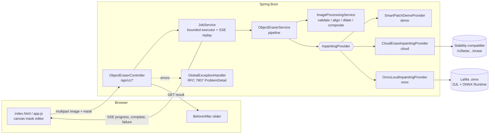

# AI Object Eraser

A real-time, full-stack object eraser inspired by Samsung Galaxy's Object Eraser. Upload a photo, paint over what you want gone, and watch the stages stream in live before comparing the result with a draggable before/after slider.

- **Backend:** Java 21, Spring Boot 4.1.2 (Maven), Spring Web, Validation, Actuator
- **Frontend:** plain HTML/CSS/JS served by Spring Boot, no Node build step
- **Engines (pluggable):** `demo` (pure Java, default), `cloud` (Stability-compatible erase API), `onnx` (local LaMa via DJL + ONNX Runtime)

## Quick start

```bash
./mvnw spring-boot:run          # Windows: mvnw.cmd spring-boot:run
# open http://localhost:8080
```

The default `demo` engine needs no API key and no model file. With Docker:

```bash
docker compose up --build
```

Run the tests with `./mvnw test`. A Postman collection (19 requests with test scripts) and sample images are in `postman/`; see [TESTING.md](TESTING.md) for the full step-by-step guide.

## Architecture



Pipeline stages (streamed over SSE): **Uploading & Validating**, **Dilating Mask Edges**, **AI Inpainting**, **Harmonizing & Finalizing**.

## Using the editor

1. Drop, choose or paste a PNG/JPG/WEBP photo.
2. Paint over the object. Adjust **Brush size**, use **Undo / Redo** (`Ctrl/Cmd+Z`, `Ctrl/Cmd+Shift+Z`, `[` and `]` change brush size), **Clear mask**, or toggle **Show mask**.
3. **Edge grow** sets how many pixels the mask is dilated by (default 6) so shadows and halos disappear with the object.
4. Press **Erase**. Drag the handle to compare, then download as PNG or WEBP. **Erase more from this result** feeds the result back in as a new photo.

The browser exports the mask as a strictly binary PNG (`0` = keep, `255` = erase) at the exact pixel size of the photo. The uploaded photo is the browser's rendering of your file (EXIF rotation already applied), so mask and photo always line up. WEBP download is encoded in the browser; the server returns PNG (or JPEG with `format=jpeg`).

## REST API

| Method | Path | Description |
| --- | --- | --- |
| `POST` | `/api/v1/erase` | Synchronous. Multipart: `image`, `mask`, optional `growMask` (0-64), optional `format` (`png`/`jpeg`). Returns image bytes. |
| `POST` | `/api/v1/erase/async` | Same inputs. Returns `202 {jobId, streamUrl, resultUrl}`. |
| `GET` | `/api/v1/erase/stream/{jobId}` | SSE. Events: `progress` (repeated), then `complete` or `failure`. Late subscribers get the full history replayed. |
| `GET` | `/api/v1/erase/result/{jobId}` | The finished image (`409` while running or failed, `404` if unknown/expired). |
| `GET` | `/api/v1/info` | Active provider and limits. |
| `GET` | `/actuator/health` | Health probe. |

```bash
curl -F image=@photo.png -F mask=@mask.png -F growMask=8 \
     http://localhost:8080/api/v1/erase -o erased.png
```

Every error is an RFC 7807 `application/problem+json` document with `type`, `title`, `status`, `detail` and `timestamp`.

## Switching providers

Set `ai.eraser.provider` in `application.yml`, or use an environment variable.

### `demo` (default)

```bash
./mvnw spring-boot:run
```

Pure-Java inward diffusion: the hole is filled layer by layer from its border, relaxed with Gauss-Seidel smoothing, and re-grained to match the surrounding noise. It works well on skies, walls, sand, water and other smooth backgrounds. It cannot invent structure, so on strongly textured or patterned areas it produces a smooth smudge. Use `onnx` or `cloud` for those.

Tunables: `ai.eraser.demo.smoothing-passes`, `grain`, `seed`.

### `cloud`

```bash
export STABILITY_API_KEY=sk-...
AI_ERASER_PROVIDER=cloud ./mvnw spring-boot:run
```

Calls `POST {base-url}/v2beta/stable-image/edit/erase` (multipart `image`, `mask`, `grow_mask`, `output_format`).

| Property | Default | Notes |
| --- | --- | --- |
| `ai.eraser.cloud.base-url` | `https://api.stability.ai` | Use `https://stability.comfy.org` for the Comfy gateway. |
| `ai.eraser.cloud.api-key` | `${STABILITY_API_KEY}` | Required. |
| `ai.eraser.cloud.api-key-header` | `Authorization` | Set to `api-key` for gateways that expect that header. |
| `ai.eraser.cloud.api-key-prefix` | `"Bearer "` | Use `""` together with `api-key-header: api-key`. |
| `ai.eraser.cloud.grow-mask` | `0` | Server-side grow (0-20). The local dilation already grows the mask. |
| `ai.eraser.cloud.output-format` | `png` | `png`, `jpeg` or `webp`. Keep `png`/`jpeg`: the JVM reads those natively. |

If your gateway authenticates differently from the defaults, adjust `api-key-header` and `api-key-prefix`; a 401/403 error message points you there.

### `onnx`

1. Download a fixed-size LaMa ONNX export, for example [Carve/LaMa-ONNX](https://huggingface.co/Carve/LaMa-ONNX) (`lama_fp32.onnx`, 512x512, inputs `image` and `mask`).
2. Put it at `models/lama_fp32.onnx`.
3. Start:

```bash
AI_ERASER_PROVIDER=onnx ./mvnw spring-boot:run
# or a custom path:
AI_ERASER_PROVIDER=onnx AI_ERASER_ONNX_MODEL_PATH=/data/lama.onnx ./mvnw spring-boot:run
```

The model runs on 512x512 tiles, so the provider crops a square around your mask (plus `context-margin` of surrounding context), inpaints it, scales it back and pastes only the masked pixels. The app fails fast at start-up with a clear message if the model file is missing. The first run downloads nothing: the ONNX Runtime native library ships inside the DJL engine dependency.

## Configuration reference

All keys live under `ai.eraser` in `src/main/resources/application.yml`, each documented inline: `provider`, `dilation-radius` (default 6), `feather-radius`, `limits.max-file-size`, `limits.max-pixels`, `jobs.concurrency`, `jobs.queue-capacity`, `jobs.ttl`, plus the `demo`, `cloud` and `onnx` blocks. Environment variables work through Spring's relaxed binding (`AI_ERASER_DILATION_RADIUS=10`).

## Project layout

```
src/main/java/com/example/objecteraser
  config/      EraserProperties, AsyncConfig
  controller/  ObjectEraserController
  dto/         Stage, ProgressEvent, EraseOptions, EraseResult, JobCreatedResponse, ServiceInfo
  exception/   InvalidImage/Inpainting/JobNotFound/JobNotReady exceptions, GlobalExceptionHandler
  service/     ImageProcessingService, ObjectEraserService, JobService, Job
  service/provider/  InpaintingProvider, SmartPatchDemoProvider, CloudEraseInpaintingProvider, OnnxLocalInpaintingProvider
  util/        ImageUtils, DiffusionInpainter
src/main/resources/static   index.html, styles.css, app.js
src/test/java               ImageProcessingServiceTest, ObjectEraserControllerTest
```

## Operational notes

- Jobs are held in memory and purged after `jobs.ttl`; run a single instance, or add sticky routing plus a shared store before scaling out.
- Inpainting concurrency is bounded (`jobs.concurrency`); overflow returns `429`.
- Uploads are validated by magic number, file size and pixel count (decompression-bomb guard) before full decoding.
- Container image uses a glibc base (`eclipse-temurin:21-jre-jammy`) because ONNX Runtime's natives do not run on Alpine.
